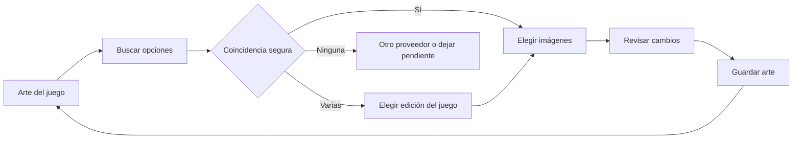

# Obtener y elegir arte con mando

Estado: implementados búsqueda, selección, revisión y guardado individual, completar faltantes por lote, cancelación en el host, rotación seleccionada y deshacer persistente. La resolución manual de coincidencias y la búsqueda con teclado en pantalla siguen pendientes. Este flujo se aplica al arte; actualizar descripciones y géneros es una tarea separada.

## Cómo usar el flujo implementado

Para un juego: **Gestión → Metadatos → juego → Arte → Buscar imágenes → Buscar opciones**. Elige una pestaña (Portada/Fondo/Logotipo), abre la imagen con Confirmar y pulsa **Usar imagen**. En fondos también puedes **Añadir a rotación** (hasta tres adicionales). Pulsa **Revisar cambios → Guardar arte**. Volver cierra primero el preview; al salir con elecciones pendientes se confirma su descarte. **Cambiar arte** en la ficha de Jugar abre el mismo recorrido.

Para completar la biblioteca: **Gestión → Metadatos → Completar arte faltante**. Selecciona juegos, pulsa **Buscar arte para N juegos**, revisa propuestas y guarda. El host consulta solo los tipos vacíos; un juego puede abrirse para comparar, mantener un tipo vacío o excluirse del lote. El límite visible es 200 juegos por operación; puedes continuar con otro lote. Cancelar detiene las consultas y permite revisar resultados parciales.

En la revisión final del asistente de primera configuración también aparece **Completar arte faltante** cuando la biblioteca importada conserva tipos de imagen vacíos. La acción usa los proveedores ya activados y sus credenciales guardadas, permite revisar propuestas y solo publica lo que se confirme. No es necesario volver a importar Steam; si no hay proveedor activado, el asistente ofrece configurarlo primero.

Después de guardar puedes **Deshacer último cambio**, también desde el listado de Metadatos después de reiniciar. Los proveedores deben estar activados; las credenciales se resuelven en Go. No hace falta volver a importar Steam.

## Idioma y títulos

Antes de crear el primer perfil, Gemu solicita el idioma de la aplicación (español o inglés). La preferencia se conserva localmente y también se puede cambiar en **Ajustes → Idioma de la aplicación**. El idioma se envía al importar Steam para solicitar el nombre, la descripción y los géneros de Steam Store, y a SteamGridDB para descartar arte cuyo idioma esté etiquetado como incompatible; recursos sin etiqueta se conservan. El título localizado de Steam reemplaza al del manifiesto local (que puede estar en otro idioma); si la consulta no devuelve nombre, se conserva un título localizado previamente y, si no existe, el título detectado.

## Importación de Steam

Con los proveedores activados en Información y arte, el recorrido existente es **Gestión → Juegos → Steam → Actualizar Steam → elegir cuenta → Obtener metadatos y continuar → Finalizar e incorporar juegos**. Descargar no equivale a publicar: el último paso incorpora los cambios a la biblioteca.

El resultado se inspecciona en **Gestión → Metadatos → juego → Arte → Galería**. Guardar una credencial no activa por sí solo el proveedor: hay que comprobar acceso y finalizar con la preferencia de activación en Información y arte.

El recorrido de importación tenía un problema de descubrimiento y control: obtener arte obliga a repetir la importación de Steam, la galería no permite elegir imágenes y los campos de rutas propias requieren texto y aún son borradores. La nueva tarea debe poder actualizar un juego existente sin redetectar instalaciones, elegir una cuenta de Steam ni consultar logros.

## Entradas visibles

| Lugar | Acción | Destino |
| --- | --- | --- |
| Ficha de un juego en Jugar | Cambiar arte | Arte de ese juego, con su selección actual |
| Gestión → Metadatos | Completar arte faltante | Seleccionar juegos del lote y revisar resultados |
| Gestión → Metadatos → juego → Arte | Buscar imágenes | El mismo recorrido individual |
| Gestión → Metadatos → juego → Arte | Buscar imágenes | El mismo recorrido individual |
| Proveedor recién activado | Buscar arte ahora | Gestión → Metadatos, conservando el proveedor activado |

Configurar proveedores queda como acción secundaria. Si el usuario ya los activó, no vuelve a introducir credenciales ni a recorrer asistentes de configuración. Todas las entradas son botones visibles; no se exige descubrir un atajo del mando.

## Recorrido individual

### 1. Arte del juego

Título y miniatura del juego, con tres filas: **Portada**, **Fondo**, **Logotipo**. Cada fila indica «Actual», «Sin imagen» o «Elegida por ti» y muestra una miniatura. El selector ofrece cuatro tipos: Grid / Portada, Fondo, Logotipo e Icono. Los grids se muestran completos en las tarjetas; el logotipo sustituye al título visual con respaldo textual, y el icono identifica el juego junto a su nombre.

El foco inicial está en **Buscar opciones**. Debajo se muestran los proveedores activados y un botón secundario **Cambiar proveedores**. Se respeta la prioridad ya configurada; cambiar los proveedores para esta búsqueda no modifica las preferencias globales.

Buscar prepara propuestas para los tres tipos, conserva el arte actual y no cambia la biblioteca. Abrir una fila permite buscar solo ese tipo. Se identifica el juego mediante su asociación disponible; no se pide escribir su nombre en el recorrido normal.

### 2. Buscar y resolver coincidencias

Se muestra «Buscando imágenes para [juego]», proveedor consultado, contador de resultados y **Cancelar búsqueda**. No se inventa un porcentaje para peticiones sin progreso medible.

Una asociación por ID o una coincidencia exacta única permite pasar a imágenes. Si hay varias coincidencias, se muestran hasta seis fichas por página con título, plataforma, año/edición cuando estén disponibles y miniatura. El usuario confirma una ficha; no se elige silenciosamente una secuela ni otra plataforma. La asociación elegida se guarda junto con el arte solo al confirmar el último paso.

Sin coincidencia: **Probar otro proveedor**, **Ver otras coincidencias** si el proveedor las ofrece y **Dejar pendiente**. Una búsqueda por texto es opcional y requiere teclado en pantalla manejable con mando antes de habilitarla. No debe abrir un campo que obligue a usar teclado físico. Los sistemas retro necesitan primero su asociación de plataforma; el adaptador actual solo cubre PC Windows.

### 3. Elegir imágenes

Pestañas visibles **Grid / Portada / Fondo / Logotipo / Icono**, cada una con indicador de selección pendiente. Se abre primero el tipo solicitado o, en una búsqueda general, Portada. La imagen actual aparece como primera opción con la etiqueta **Mantener actual**.

Se muestran seis candidatos por página, con miniatura, proveedor y dimensiones. La prioridad y calidad ordenan las opciones; la etiqueta **Recomendada** orienta, pero no sustituye la elección. Los fondos deben cumplir las dimensiones reales aceptadas por el escenario. Se ofrecen grids de distintos tamaños y orientaciones; las tarjetas conservan la imagen completa sin recortarla. No se mezclan capturas pequeñas con fondos de escenario.

Al confirmar una miniatura se abre una vista grande y fija. En un fondo, se superponen el título y los controles de Gemu para comprobar legibilidad; no hay carrusel ni rotación automática durante la comparación. Acciones: **Usar imagen**, **Volver a opciones** y **Detalles**. El fondo admite también **Añadir a rotación**, sin sustituir el principal. La rotación contiene solo fondos elegidos, no todas las imágenes descargadas.

La selección muestra un check y el texto **Seleccionada**. El borde de foco indica dónde se actuará, de forma distinta al estado seleccionado. Confirmar otra portada o logotipo reemplaza la propuesta anterior de ese tipo. Cambiar de página o pestaña conserva las propuestas y el foco por imagen.

El footer ofrece **Revisar cambios** y **Volver**. Revisar se habilita cuando existe al menos un cambio válido. Si se mantienen todos los valores actuales, se indica **Sin cambios**.

### 4. Revisar y guardar

Una comparación **Actual / Elegida** por tipo, con páginas simples y un resumen: «1 portada, 1 fondo principal, 2 fondos añadidos». Los tipos que no cambian se identifican como **Se conserva**.

Acciones: **Guardar arte** y **Seguir eligiendo**. Guardar publica únicamente el arte confirmado de este juego; no usa el botón general «Guardar borrador» de Gestión. Durante la escritura se muestra **Guardando arte…**, se evita doble confirmación y no se permite salir hasta conocer el resultado.

Al terminar, se actualizan inmediatamente la ficha, portada del catálogo y escenario. Se vuelve al origen con el foco en **Cambiar arte** o **Buscar imágenes** y un mensaje «Arte guardado». Una acción **Deshacer último cambio** restaura las selecciones anteriores de esta operación. No se borran imágenes anteriores mientras puedan usarse para restaurar.

## Varios juegos

**Gestión → Metadatos** ofrece tres tareas: **Completar imágenes faltantes**, **Elegir juegos** y **Elegir arte de un juego**. Se muestran sus cantidades antes de iniciar. Se excluyen juegos de demostración sin entrada persistida.

1. **Elegir alcance.** Completar faltantes usa juegos que carecen de al menos uno de los tipos solicitados. Un escenario procedural cuenta como fondo faltante; una imagen válida de Steam cuenta como existente. Si no falta nada, se explica y se ofrece Elegir juegos. La selección manual usa fichas con check, seis por página, contador global y botones Elegir página / Quitar página. No hay selección implícita de otra página.
2. **Definir cambios.** Tipos solicitados: Portadas y Fondos por defecto; Logotipos opcional. Modo recomendado: **Solo completar lo que falta**. Alternativa: **Proponer reemplazos**, que exige revisión individual y nunca reemplaza una elección manual de forma automática. Se muestran proveedores activados, prioridad y número exacto de juegos afectados. Acción: **Buscar arte para N juegos**.
3. **Buscar.** Progreso por juegos realmente terminados: «12 de 40», juego/proveedor actual y contadores Encontrado / Sin coincidencia / Pendiente. Cada operación usa concurrencia limitada y respeta cuotas. Se puede cancelar y revisar lo obtenido; no se aplica nada en segundo plano.
4. **Revisar resultados.** Resumen y lista paginada. En completar faltantes se preseleccionan solo propuestas válidas de coincidencias seguras y tipos vacíos. Cada juego puede excluirse o abrirse para comparar. En reemplazos se revisa y confirma cada juego: no hay botón «Reemplazar todos». Las coincidencias ambiguas quedan pendientes hasta resolverlas.
5. **Guardar.** El botón expresa alcance: **Guardar arte de N juegos**. Si solo hay incidencias, se ofrecen Reintentar pendientes y Volver, sin un guardado vacío. El guardado afecta únicamente esos juegos y tipos; los demás mantienen su estado. La vista final muestra los cambios y pendientes, permite deshacer la operación y devuelve el foco a la tarea de origen.

## Navegación con mando

La interfaz utiliza acciones lógicas Confirmar y Volver y sus glifos según el perfil de mando existente. No se deducen las letras por la marca: Nintendo y mandos remapeados pueden tener otras asignaciones.

| Entrada | Comportamiento |
| --- | --- |
| Cruceta o stick | Mover foco entre pestañas, fichas y acciones; sin activar al pasar |
| Confirmar | Abrir una fila/imagen, alternar selección o ejecutar el botón enfocado |
| Volver | Cerrar primero la vista previa; después volver un paso |
| LB/RB, si están asignados | Cambiar página como atajo opcional |
| Botones Anterior / Siguiente | Cambiar página sin depender de gatillos ni atajos |

Un solo foco activo y visible. Al abrir una vista previa se coloca en **Usar imagen**; al cerrarla vuelve a su miniatura. Volver a un listado recupera juego, página y tipo. Las actualizaciones asíncronas no desplazan el foco ni sustituyen el control debajo de una confirmación mantenida. Confirmar y Volver actúan una vez por pulsación.

Encabezado y footer permanecen visibles; sin scroll general, hover, menús de clic derecho, select nativos, doble clic ni arrastre. Las seis fichas se adaptan al tamaño disponible; a 720p se reduce su número antes de encoger texto o recortar acciones. Todos los cambios de página son explícitos y los límites no trasladan el foco a la barra lateral.

Desde una búsqueda, Volver abre **Cancelar búsqueda / Seguir buscando**, con foco inicial en Seguir buscando. Cancelar detiene peticiones reales y ofrece Revisar resultados / Descartar. Al salir con propuestas sin guardar, se muestran **Seguir eligiendo / Descartar cambios**. Un cambio de perfil cancela y descarta la operación del perfil anterior; no transfiere resultados al nuevo.

## Errores y estados

| Estado | Respuesta visible |
| --- | --- |
| Proveedores configurados pero desactivados | Activar proveedor; retomar después el mismo juego/alcance |
| Sin credenciales o acceso rechazado | Configurar conexión / Usar el otro proveedor; nunca pedir credenciales de desarrollador al usuario |
| Un proveedor agotó cuota o falló | Continuar con el disponible, conservar propuestas y marcar pendientes; sin reintentos continuos |
| Ningún proveedor disponible | Reintentar / Configurar conexiones / Volver, conservando el arte publicado |
| Sin resultados o coincidencia ambigua | Dejar pendiente o resolver; conservar imagen actual |
| Miniatura falla o imagen inválida | Quitar ese candidato y dejar el foco en el siguiente control válido; permitir otro candidato |
| Error al guardar | Mantener revisión y propuestas; Reintentar guardado / Volver a elegir |
| Biblioteca cambió durante la revisión | Volver a revisar los juegos afectados; no sobrescribir selecciones nuevas |

**Configurado**, **Activado**, **Buscando**, **Propuesta** y **Guardado** tienen significados distintos. Comprobar credenciales no descarga arte; encontrar una imagen no significa que ya esté en el catálogo. Las incidencias aparecen por juego y proveedor, sin cuerpos HTTP ni URLs autenticadas.

## Contrato del host

Se reutilizan controles de TV, credenciales del backend, consulta de proveedores y validación/caché de imágenes. El actual `PrepareLibraryImport` no sirve como guardado individual: su commit reemplaza la fuente completa. El nuevo recorrido necesita una operación independiente de arte sobre IDs de juegos existentes.

- Separar resolución de coincidencias, listado de candidatos y descarga de seleccionados. `ContentProvider.Fetch` y `enrichMetadata` actuales eligen/limitan arte durante la importación; no proporcionan una galería completa para elegir.
- Crear operaciones con ID, progreso estructurado, estado y cancelación mediante contexto en el host. Ignorar una promesa en el frontend no cancela las peticiones. Limitar peticiones y tamaños de lote; no hacer una descarga ilimitada de imágenes en tamaño completo para navegar miniaturas.
- Preparar candidatos y miniaturas locales con proveedor, ID, dimensiones y procedencia. Las selecciones pendientes y la asociación de juego pertenecen al perfil y a la operación; el frontend no recibe secretos ni URLs autenticadas.
- Persistir por juego la portada elegida, fondo principal, fondos de rotación, logotipo e indicación de elección manual. Migrar bibliotecas antiguas usando sus selecciones actuales; los logotipos no tienen hoy un campo de selección explícita.
- Publicar únicamente los tipos confirmados sobre la última biblioteca, con revisión de conflictos y escritura atómica. Las instalaciones, fuente, logros, perfiles y metadatos ajenos al arte permanecen iguales.
- Guardar el estado anterior para deshacer la última operación, también después de reiniciar. Deshacer valida que no haya cambios posteriores en esos tipos; en caso de conflicto ofrece revisión y evita un reemplazo silencioso.
- Propagar el snapshot publicado a Jugar y Gestión. Un cambio de imagen invalida su preview en memoria; el foco se conserva por ID de juego/imagen.

## Alcance y aceptación

1. **Arte de un juego:** botón visible, búsqueda, elección de portada/fondo/logotipo, revisión, guardado real y deshacer. Funciona con los dos proveedores ya activados, sin reimportar Steam.
2. **Completar biblioteca:** selección paginada, progreso, cancelación efectiva, revisión y guardado de resultados parciales.
3. **Coincidencias y detalles:** elección de edición, asociaciones persistidas, proveedores por operación y búsqueda opcional con teclado en pantalla. Si el primer incremento solo admite coincidencia segura, la UI debe mostrar las otras como pendientes.

Pruebas necesarias: cancelación impide publicar; un commit no cambia otro juego ni logros; completar conserva imágenes existentes; prioridad no elimina selecciones manuales; una imagen inválida no se publica; fallos/cuotas conservan resultados válidos; el cambio de perfil no mezcla operaciones; conflicto y deshacer no pisan cambios posteriores.

Validación visual y de entrada: recorrer todas las acciones con mando a 720p/1080p, sin ratón ni teclado físico; mantener Confirmar al cambiar pantalla; volver desde preview, paginación, búsqueda y revisión; comprobar foco al fallar una miniatura y al terminar un lote. El flujo solo se considera usable cuando estos recorridos funcionan con un dispositivo real.

### Límites del incremento

Las portadas horizontales de al menos 1280 × 720 también pueden usarse como fondos: la portada seleccionada entra automáticamente en la rotación y la vista previa permite añadir otra portada apta como fondo adicional. Se conserva su clasificación de portada y su uso en las fichas. El escenario mantiene sus transiciones de 1,4 segundos y el intervalo de 18 segundos entre imágenes, según las preferencias de movimiento.

La galería descarga y valida candidatos con límites (hasta seis por tipo/proveedor para un juego; una opción por tipo/proveedor en completar faltantes). Usa las coincidencias seguras de los adaptadores existentes; las ambiguas se presentan como incidencias y no se publican automáticamente. La elección manual de edición, proveedores por operación, carga de archivos propios y teclado en pantalla no forman parte de este incremento. Las rutas propias anteriores siguen siendo borradores.

No se pudo verificar visualmente el recorrido ni con un mando físico: el servicio nativo de computer-use no estaba disponible. Pruebas Go, pruebas frontend y compilación validan el guardado, cancelación, conservación de datos, deshacer y puente actualizado.
