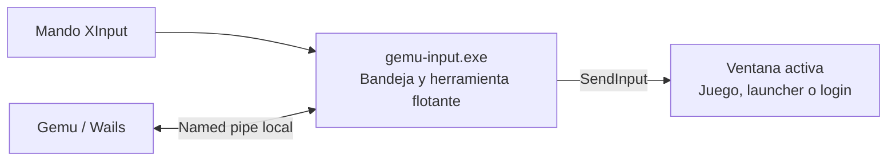

# Asistencia de escritorio en Windows

`gemu-input.exe` es un proceso independiente por usuario y sesión de Windows.
Gemu lo inicia cuando está instalado junto al ejecutable principal; también se
puede ejecutar directamente. Al cerrar Gemu, el asistente permanece en la bandeja.
El menú de su icono permite abrir ratón o teclado, ocultar la herramienta y salir.
No se instala como servicio de Windows ni se configura para arrancar con Windows.

## Uso con mando

- Home + X: abrir/cerrar el teclado flotante sobre la ventana externa activa.
- Home + R3: abrir/cerrar el ratón virtual.
- Si Home no está disponible por XInput, mantener View + Menu y añadir X o R3.
- Home solo, o View + Menu sin otro botón: abrir el menú de partida al soltar la
  combinación, mientras Gemu tenga una sesión activa.
- También se puede elegir **Asistencia de escritorio** desde el menú de partida,
  incluso mientras se espera detectar el proceso del juego.
- Dentro de Gemu se conservan el teclado HTML Home + X y el ratón HTML R3.

La asistencia requiere soltar los botones antes de operar tras abrir el panel o
cambiar de mando. En modo ratón, el stick izquierdo mueve el cursor del sistema;
A mantiene el botón izquierdo (permite arrastrar), X hace clic derecho y el stick
derecho vertical desplaza. LB/RB envían Shift+Tab/Tab. Y abre el teclado y B sale.

En el teclado, cruceta/stick elige, A escribe, X borra, Y alterna mayúsculas, LB
alterna símbolos y RB inserta un espacio. Incluye todos los caracteres ASCII
imprimibles, letras españolas, Tab, Enter, Escape y flechas para mover el cursor
de texto. «Listo» cierra sin enviar Enter. B cierra la herramienta sin enviar
Escape a la aplicación; la tecla Esc del panel sí envía Escape.
«Mover» alterna el panel entre arriba y abajo para descubrir el campo de texto.

La ventana flotante usa `WS_EX_NOACTIVATE`: no se convierte en el destino del
texto al seleccionar teclas. Envía Unicode mediante `SendInput`, directamente al
campo enfocado de la aplicación. No lee ni guarda el contenido de campos externos
ni muestra una copia de las contraseñas. Si cambia el foco a otra ventana durante
la escritura, cierra el teclado. Al desconectar el mando, cerrar la asistencia o
salir del proceso, libera el clic que mantenía pulsado.

## Separación y comunicación



El asistente lee XInput y resuelve las combinaciones globales fuera del WebView.
Gemu consulta su estado cada 100 ms y entrega a su gestor de sesiones las
solicitudes de menú. Mientras el asistente responde, el host deja de sondear
XInput para ese atajo; F10 permanece en el host. Home solo se resuelve al soltar
para no competir con Home + X. La navegación ordinaria de la biblioteca conserva
el lector del navegador y se pausa mientras la asistencia está activa.

El servidor es un named pipe con ACL del usuario actual, separado por sesión y
con clientes remotos rechazados. No abre puertos HTTP. Solo admite estado,
abrir ratón/teclado y ocultar; no expone una API para inyectar texto arbitrario.
El contenido escrito no cruza el canal de control. La conexión no controla el
ciclo de vida del asistente: desconectar Gemu no lo termina. Si el asistente deja
de responder, el host vuelve a su lectura de atajos existente.

## Compilación y comprobaciones

`build.ps1` y `dev.ps1` compilan el asistente mediante
`scripts/build-input-assist.ps1` y lo colocan en `build/bin/gemu-input.exe`.
Para compilarlo por separado:

```powershell
go build -ldflags '-H=windowsgui' -o build/bin/gemu-input.exe ./cmd/input-assist
go test ./internal/assist ./internal/launcher ./internal/overlay
```

Las pruebas cubren resolución y liberación de combinaciones, repertorio de
caracteres, disposición nativa de INPUT/XINPUT_STATE, comunicación real por pipe,
instancia única y transferencia de solicitudes del overlay. La navegación del
frontend tiene pruebas de pausa y acceso a la asistencia antes de confirmar el
proceso de un juego.

## Límites y validación con hardware

- El backend nativo admite mandos expuestos como XInput. Un mando que solo tenga
  un mapeo válido en el navegador todavía no está cubierto fuera de Gemu.
- Leer XInput no consume el estado del dispositivo para otras aplicaciones.
  El juego puede recibir los mismos botones usados para operar la asistencia.
  Este incremento no instala filtros HID ni garantiza captura exclusiva.
- Una ventana siempre visible funciona sobre el escritorio y juegos en ventana
  o sin bordes; no garantiza aparecer sobre pantalla completa exclusiva.
- Windows limita `SendInput` a aplicaciones de igual o menor nivel de integridad.
  No se eleva el asistente automáticamente ni se cubren UAC/escritorio seguro.
- Algunos juegos no aceptan texto Unicode sintetizado o entrada de ratón nativa.
  El cursor también puede ser ocultado o confinado por el propio juego.
- Steam Input y Game Bar pueden responder a Home. El asistente no cambia sus
  ajustes ni intercepta sus entradas.
- La UI nativa inicial está en español. El menú de acceso de Gemu y el overlay
  conservan su localización española/inglesa.

Antes de declarar compatible un juego: probar con mando real un login de launcher,
Tab entre usuario/contraseña, símbolos, Enter, menús, arrastre y desplazamiento;
cambiar foco durante escritura; desconectar manteniendo A; cerrar Gemu y continuar
desde la bandeja; salir y reabrir sin instancias duplicadas; probar varios monitores
y escalas DPI. Repetir con Steam Input y Game Bar para detectar doble entrada.

## Relación con Steam

Valve documenta configuraciones distintas para Big Picture, escritorio y juegos
en [Getting Started for Players](https://partner.steamgames.com/doc/features/steam_controller/getting_started_for_players),
y un teclado flotante que envía entrada al juego en
[ShowFloatingGamepadTextInput](https://partner.steamgames.com/doc/api/ISteamUtils#ShowFloatingGamepadTextInput).
Eso respalda separar interfaz, mapeo y envío de entrada; no demuestra una topología
interna concreta de procesos o servidores de Steam.

Microsoft documenta el aislamiento de servicios en sesión 0 en
[Interactive Services](https://learn.microsoft.com/en-us/windows/win32/services/interactive-services)
y las restricciones de entrada en
[SendInput](https://learn.microsoft.com/en-us/windows/win32/api/winuser/nf-winuser-sendinput).
